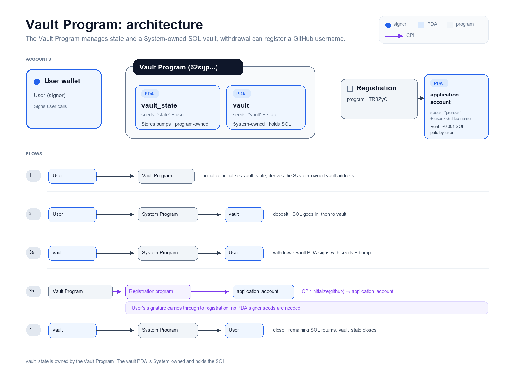

# Pre-req Vault

Solution for the Turbin3 Q4 2026 Builders Cohort prerequisite challenge (Part 1).

An Anchor vault program on Solana devnet. A user can create a personal vault,
deposit SOL into it, withdraw SOL, and close it. The `withdraw` instruction has
been extended with a Cross-Program Invocation (CPI) to the Turbin3 registration
program, which records my GitHub username on-chain.

## Deployed program

| Item | Value |
|---|---|
| Cluster | devnet |
| Program ID | `62sijpioeoxJR7HaLjtxpzA1Kwf6ruk3qZyf8oXNxRav` |
| Registration program | `TRBZyQHB3m68FGeVsqTK39Wm4xejadjVhP5MAZaKWDM` |
| Registration account (PDA) | `GSSpys6BcUCQacBWkNwiuRsHJ6oaFgpEAgeC65EiNAMk` |
| Withdraw tx (includes the CPI) | `34L37uWfVmqWwpqJ6SbE9TCKUjKswN6afdmQmE3uJj2qKJC2xocAufMHN4sTJgM2AYoDh4AaygXhfNdtHi8SxrLB` |

## How it works

| Instruction | What it does |
|---|---|
| `initialize` | Creates the `vault_state` PDA (stores the bumps) and sets up the vault PDA |
| `deposit` | Transfers SOL from the user to the vault PDA |
| `withdraw` | The vault PDA signs a transfer back to the user, then CPIs to the registration program |
| `close` | Returns the remaining SOL to the user and closes `vault_state` |

PDAs:
- `vault_state`: seeds `["state", user]`
- `vault`: seeds `["vault", vault_state]`
- registration `application_account`: seeds `["prereqs", user]`, owned by the registration program

## What I changed

In `programs/pre-req-vault/src/instructions/withdraw.rs`, after the SOL transfer,
`withdraw` now calls the registration program's `initialize` instruction through
a CPI, passing my GitHub username. The `user` signature carries over from the
outer transaction, so no extra signer seeds are needed for this call.

## Architecture diagram



## Video walkthrough

https://youtu.be/dRIww5uu9Ds

## Run the tests

```bash
anchor build
anchor deploy
anchor test --skip-local-validator --skip-deploy
```

Note: each wallet can only register once, so re-running the `withdraw` test with
a wallet that is already registered will fail.
